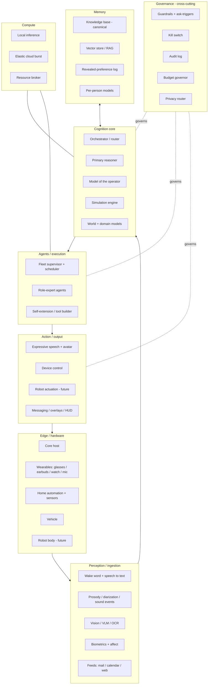

# Minerva: system architecture

The design document behind this repository: how the pieces of a personal AI agent were meant to
fit together, what was actually built, and in what order. It was written in June 2026 as a living
document, one section at a time while the code was being built, and is published here with the
private context taken out. The runtime in this repository is the first tier of it; most of the
layers below were designed and never started, and the tables say which.

The code cites this document by section ("architecture §2d") and by build track ("Track N"), so
both keep their original numbering. The [engine interface spec](engine-interface.md) is the
detailed companion for sections 2b to 2d.

**Status tags** in section 3 describe the outside world when the design was written, not this
repository: [exists] off-the-shelf, integrate it; [build] Minerva builds it.

## 0. Built versus designed (at the park, June 2026)

The design kept a scoreboard, updated every build round, measuring what was built against what
the design called for. This is its final state.

| # | Pillar | Design target | Built | Biggest gap |
| --- | --- | --- | --- | --- |
| 1 | Always-on proactive core | It exists, watches, acts and reaches the operator; self-generated drive ticks feed the same governed loop | The engine seam with three adapters, the governed gateway as the only tool source, the hash-chained ledger and the anti-nag proposal index, and approvals with honored retry. Scheduled brainstorm ticks, a morning brief and two-way Discord chat with file transfer. A mail trigger that wakes a small, bounded, governed session to decide whether a message is worth a ping now. An engine lock (one main session at a time), a daemon heartbeat and an independent watchdog. A standing agenda that survives between sessions, with at most 25 open agenda items. | Calendar and sensor triggers; the mail trigger decides but cannot act, since write-class tools wait on the inline warden being switched on |
| 2 | Integration with the operator's own data | A knowledge base, mail, calendar, feeds | Read-only, manifest-routed search of the knowledge base with file and line citations; observations reach it only through reviewable drop files; governed web reads and a contained file workspace; image and video generation through the gate; dormant read-only mail (IMAP) and calendar (ICS) connectors that Minerva can discover and ask the operator to switch on, through the anti-nag ledger | Feeds and other data sources never wired |
| 3 | Working agents that produce value | Delegated research and work-automation jobs | An event-sourced job queue and an orchestrator that runs each delegated goal as its own governed agent session in an isolated state folder, on 3 worker threads, with at most 25 pending jobs. Each job checks the shared kill switch while it runs and the shared daily budget before it starts, and a job times out after 300 seconds by default | The mechanism exists; no standing value-producing job was built on it. Sub-jobs do not run yet (see the README's Known gaps) |
| 4 | Voice | Wake word, always-on listening, expressive speech | Not started | A speaker policy has to come before any always-on listening |
| 5 | A model of the operator, and simulation | Predicting the operator's calls with measured accuracy; simulating options before acting | Data only: pitch verdicts with reasons fold into the ledger and steer the brainstorm | No model was built |
| 6 | Perception and presence | Cameras, sound, presence across devices, home automation | Not started | – |
| 7 | Avatar and visual identity | 2D first, 3D later | Not started (the generation lane would serve it) | – |
| 8 | Hardware | A modular wearable kit | Not started | – |
| R | Rails (Tracks H and N) | Guardrails, kill switch, audit, budget, privacy, a content boundary, a warden | The governance gate with ask classes, a spend threshold, fingerprinted approvals and standing denials; the hash-chained audit ledger; real-dollar metering, and a rolling daily budget across the lanes that report dollars; per-lane tool allowlists; an SSRF-guarded read-only web tool and a contained workspace; secrets in git-ignored files; the file-based kill switch; a post-hoc warden; an inline warden (off by default); a replay tool that re-runs history against the current policy | The external-content boundary is advisory, not structural; the hosted-open chat lane meters tokens, not dollars; the inline warden was never switched on |

## 1. Layered model

What this repository implements of it: the governance column almost entirely, the core's
orchestrator and router (the engine registry, the job orchestrator), a canonical knowledge base
read through a search tool, mail and calendar feeds behind dormant connectors, and messaging as
the only output.

## 2. The main loop

sense → perceive → assemble the state of the world → retrieve (memory and the model of the
operator) → simulate and score options → governance check (ask?) → dispatch agents → act → log
back to memory

Always on and event-driven: a wake word, a sound, a calendar trigger, a direct request or a
**drive tick** all enter the same loop. Drive ticks are self-generated events (idle-time
brainstorming, scheduled scans, upkeep), the mechanism behind an agent that is motivated rather
than only responsive. Every drive-originated action passes the same governance check as
everything else. In this repository the loop is the scheduled tick (`scripts/drive_tick.py`), chat
(`scripts/minerva_chat.py`) and the mail trigger (`scripts/mail_events.py`), all through one gate.

## 2b. Foundation: reference others, build lean, keep the engine swappable

The commodity parts of an agent (the loop, memory, skills, sandboxing, messaging) were being
absorbed into frontier models quickly. So the worst move was to reimplement them from scratch, and
the second worst was to import a heavy framework and its bloat. Instead:

- **Reference existing agent frameworks; don't depend on them.** Borrow specific patterns (a
  memory feedback loop, a skill curator) without importing the stack.
- **Keep the engine thin and swappable behind a clean interface**, so a frontier model's native
  agent backend can drop in later. Swap the engine; don't rewrite Minerva.
- **Spend the real effort on what won't be commoditized**: a model of the operator built from
  their own data and judgment, governance and values, persona, and deep integration with the
  operator's own data and devices.
- **The lasting value is sovereignty and personalization** (private, local-first, the operator's),
  not the generic capability, which is going mainstream regardless.

**Prior art, reviewed in June 2026.** The companion shell already existed, open source:

- **Open-LLM-VTuber** (MIT): a voice-first companion with a Live2D avatar, visual perception and
  an "implement the Agent interface" seam with swappable models, speech and memory. The closest
  match for the eventual shell; the plan was to fork it at a fixed version rather than track it.
- **Project AIRI** (MIT): a self-hosted companion framework with real-time voice, Live2D and VRM
  avatars and many model providers; the stronger 3D and mobile option.
- **Hermes Agent** (MIT): a self-improving agent with persistent memory and skills. Promoted from
  a reference to engine adapter #1, run as an external service behind Minerva's interface, never
  woven into its code.
- **OpenClaw** (MIT): a self-hosted multi-channel personal agent. Read as a security case study
  rather than a base: the incidents reported around it in 2026 (exposed control planes, a
  malicious-skill supply chain) became requirements for Track N.
- **Super Agent Party**: an all-in-one companion and agent, AGPL with a commercial license, so a
  reference install and a working definition of "done", never a source of code for an
  MIT-licensed project.
- **Vellum**: real and open, but corporate and macOS-first; a design reference for its trust and
  sandbox documents only.

The speech stack chosen for the voice tier (never reached): openWakeWord for the wake word,
Silero VAD in front of a streaming recognizer (Moonshine or faster-whisper), and Chatterbox or
GPT-SoVITS for a cloned voice.

## 2c. Sourcing map: which project for which piece

One coherent base shell, parts ported from the others, and the differentiators built. This was
the plan; the voice tier was never reached, so nothing was forked before the park.

| Piece | From | How | Why |
| --- | --- | --- | --- |
| Base shell and real-time loop | Open-LLM-VTuber | fork | Python, local, voice-first, an Agent seam for the swappable engine |
| Voice in and out | Open-LLM-VTuber | with the fork | built in, swappable engines |
| 2D avatar | Open-LLM-VTuber | with the fork | expressions and a desktop pet |
| Visual perception | Open-LLM-VTuber | with the fork | wire to a local vision model |
| Long-term memory | built | build | one pipeline: episodic store → consolidation → the knowledge base, reusing its existing review-before-filing pattern |
| 3D avatar, mobile | Project AIRI | port a part | stronger VRM rig, WebGPU and mobile |
| Agent engine | Hermes Agent | adapter #1 | an external service behind the interface |
| Messaging presence | Hermes Agent's gateway | with adapter #1 | many channels built in |
| Security lessons | OpenClaw's incidents | case study | exposed control planes, malicious skills |
| Credential isolation | Vellum | reference | trust and sandbox documents |

**Built, not borrowed:** the engine interface and its adapters, the model of the operator,
governance, the simulation and decision engine, and integration with the operator's own data.

## 2d. Deployment and model residency

**Where it runs is a deployment choice, not an architecture commitment.** The starting host was a
single always-on machine; the intended home was a cloud server, with presence across devices and
controlled migration (relocation yes, uncontrolled self-replication never). Consequences from day
one:

- **Separable services** (engine, memory, audio edge, governance), so the stack can move with a
  configuration change.
- **State separate from compute**: memory, configuration and the decision log live in storage that
  syncs; the engine is replaceable; nothing precious lives only in a process.
- **Privacy routing survives the move**: the privacy tier is about which model and provider see
  the data, not which building the box is in.

**No resident local model required.** Local models only where full control is needed;
orchestration, memory and routing run locally, and the thinking goes to hosted APIs by default. The
always-on loop is a CPU-side audio edge plus the engine, memory and governance; a local GPU, where
there is one, is a budget for optional lanes (image generation, a vision model, a local model when
the full-control tier calls for one).

**The routing dimensions:** sensitivity (privacy), capability needed, guardrail tolerance,
latency and cost. They became `RoutingHints` in `src/minerva_core/engine.py`; model residency is
just a cache decision inside them.

**Models by guardrail tier.** Frontier APIs are the high-capability lane, with the provider's
rules attached. Open-weight models hosted by providers sit in between (policies vary). Open-weight
models self-hosted or on rented GPUs are the full-control lane, where the operator carries the
responsibility. Minerva's own governance layer decides what runs where; in this repository that
is `EngineRegistry.pick()`, with the frontier, hosted-open and (unregistered) local tiers.

## 3. Component register

The full register listed about forty components across the layers of section 1, each tagged by
what existed outside the project in June 2026. Most were off-the-shelf parts to integrate later:
wake word and speech recognition, prosody and diarization, vision models, home automation, a
vector store, expressive speech and an avatar. The rest were Minerva's to build: the episodic
store and consolidation pipeline, the model of the operator, the simulation engine, the drives and
agenda loop, the proposal ledger, a fleet supervisor, role-expert agents, self-extension, a
resource broker, a speaker policy (capture gated by speaker identification, with a mute) before
any always-on listening, and governance. Governance is the part this repository built most of, so
its rows are kept; section 0's rails row says which parts were built:

| Component | Status then | Notes |
| --- | --- | --- |
| Guardrails and ask-triggers | [build] | actions that are irreversible, spend money, communicate outward, affect another person, act physically, or carry medical or legal consequence go to the operator first; sensitive actions need a second factor, since a voice alone can be cloned |
| Kill switch | [build] | outside the agent's own process tree, able to stop everything; an in-process kill switch is no kill switch |
| Audit log | [build] | append-only and tamper-evident (hash-chained), or "no hidden state" is decorative |
| Untrusted-content boundary | [build] | external content (mail, web) is data, never instructions; a stricter ask tier for actions triggered while reading it; skills only from its own code or approved sources |
| Warden and replay suite | [build] | a small second model checks planned actions against policy; replaying logged decisions regression-tests any new model, prompt or engine before it is promoted |
| Metering ledger | [build] | tokens and dollars per task from day one; a cap without a ledger is vibes |
| Budget governor | [build] | a cost cap; large spend asks first |
| Privacy router | [build] | private data stays in trusted lanes; the constraint follows the data, not the building |

## 4. Build tracks

Assembled in dependency order, not by phase or date. "Depends on" is the only sequencing that
binds.

| Track | Goal | At the park | Depends on |
| --- | --- | --- | --- |
| A — Core kernel | The engine interface and the decision and audit log schema first (they start the data flywheel and metering on day one), then adapters | built: the interface, three adapters, the gateway, the ledger | – |
| B — Voice | Always-on wake word, speech to text, expressive speech | not started | A |
| C — Perception and affect | Vision, prosody, diarization, sound events, fusion | not started | A |
| D — Model of the operator | A preference model, a revealed-preference log and an emulator built on the knowledge base | data collection only | the knowledge base |
| E — Simulation engine | Forward simulation and domain digital twins | not started | D |
| F — Agent fleet | Supervisor, scheduler, self-extension | partly built: the job queue and orchestrator; no self-extension | A, G |
| G — Elastic compute | Resource broker and cloud burst | partly built: static routing over the routing hints | A |
| H — Governance | Guardrails, ask-triggers, kill switch, audit, budget, privacy | built, except a privacy router beyond the routing rules | A; must exist before F and self-extension |
| I — Hardware kit | Integrate wearables into one system | not started | B, C |
| J — Integrations | Home automation, vehicle, messaging, feeds | partly built: Discord, read-only mail and calendar connectors, the knowledge base | A |
| K — Role agents | Expert personas with their own tools | not started | A, D |
| L — (dropped) | dropped from scope when the design was written | – | – |
| M — Avatar and visual identity | Character bible → reference set → fine-tune → image-to-3D and rig → real-time lip-sync | not started (low priority by design) | B, for lip-sync only |
| N — Integrity | The untrusted-content boundary, Minerva's own attack surface (control plane never on the internet, secrets in a vault, signed endpoints, sandboxed tools), the warden and replay suite, an external watchdog, metering, the speaker policy, operations | mostly built: both wardens, replay, the watchdog, the SSRF guard, workspace containment; the content boundary is advisory | A; blocks F and self-extension, like H |

## 4b. Build order

The order of importance (always-on proactive agent before avatar). Section 4's dependencies still
bind; this breaks the ties.

**It is a default, not a gate.** "We can't do X because we're not at that tier" is never a
reason: anything can be pulled forward when there is a reason to; only real dependencies block.
**Feasibility spikes:** anything deferred that carries a realizability risk gets a cheap early
spike (hours, not a build), so nothing unrealizable hides behind "later".

1. **Always-on proactive core**: the engine interface and an adapter, the memory pipeline, the
   decision log, a governance minimum (ask-triggers, audit, metering, watchdog) and one channel
   that reaches the operator. (Tracks A, H, N, J)
2. **Integration with the operator's own data**: the knowledge base, mail, calendar, feeds.
   Proactive suggestions need fuel. (J, D)
3. **Working agents that produce value**: delegated research and work automation. (F, K, gated by
   H and N)
4. **Voice**, with the speaker policy first. (B)
5. **The model of the operator and simulation**: the differentiators; tier 1's decision log
   collects their training data the whole time. (D, E)
6. **Perception, home and presence across devices.** (C, J)
7. **Avatar and visual identity.** (M)
8. **Hardware**: an optional, modular wearable kit (glasses, earbuds, a watch, a microphone),
   each piece wired in when it actually arrives. (I)

The repository reached tier 1 and parts of tiers 2 and 3 before the project was parked.

## History

- 2026-06-08: written: the layered model, the main loop, the component register, the build
  tracks, the hardware kit; sequencing by dependency only.
- 2026-06-09: after a review of the prior art and a spike on Hermes Agent: reference rather than
  depend, Hermes as engine adapter #1, memory built rather than borrowed, deployment and model
  residency (section 2d), the integrity track (N), drive ticks, the proposal ledger, and the build
  order with its non-gating rule.
- 2026-06-11 to 06-15: the built-versus-designed scoreboard (section 0) kept up to date each build
  round. The project was parked on 2026-06-17.
- 2026-09-30: this public edition, rewritten from the private original: the scoreboard reduced to
  its final state, the track statuses brought up to the park, the component register cut to a
  summary and its governance rows, the hardware section folded into the build order, personal
  context removed.
